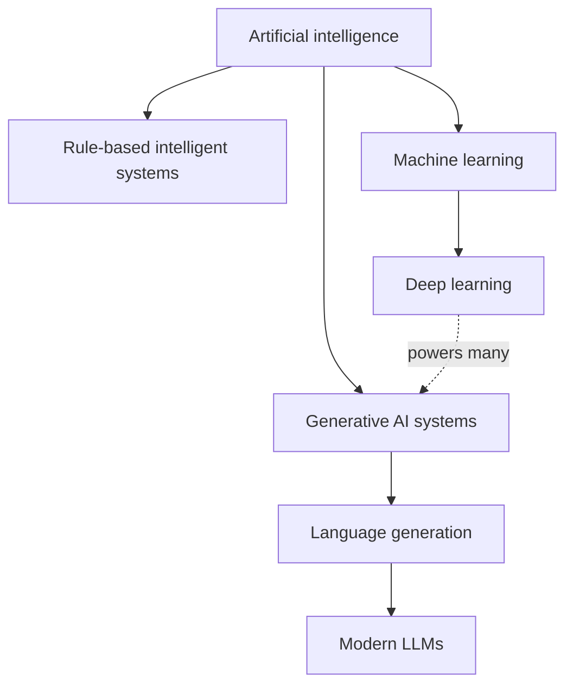

# Mission 1 — Build the AI and ML landscape

## Concept map

This is a conceptual map, not a strict taxonomy: some generative systems are not deep learning, and AI includes approaches without ML.

## Five distinctions

1. **AI vs automation:** AI is a broad effort to perform tasks requiring intelligent behaviour; a timer-controlled switch simply follows a preset sequence.
2. **Rules vs ML:** Rules are written by people; ML estimates patterns or parameters from examples.
3. **AI vs ML:** ML is one approach within AI; search, planning and expert rules can also be used in AI.
4. **ML vs deep learning:** Deep learning uses multilayer neural networks; other ML methods include decision trees and linear regression.
5. **Generative AI vs LLM:** Generative AI produces content in several media; LLMs specialise in language and are commonly based on transformer neural networks.

## Classify three examples

| Example | Classification | Reason |
|---|---|---|
| A fixed 40°C cooling switch | Conventional automation | Human-written threshold controls the output |
| Defect detector trained on wafer images | ML / classification | Learns visual distinctions from labelled examples |
| Chat assistant drafting a test plan | AI / generative AI / LLM application | Generates language using a trained language model |

A thermostat does not become ML merely because it uses a sensor. Conversely, not all AI systems learn from data. [S1]
