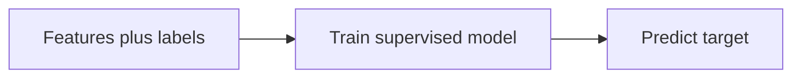
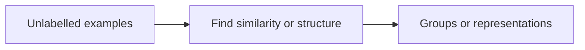
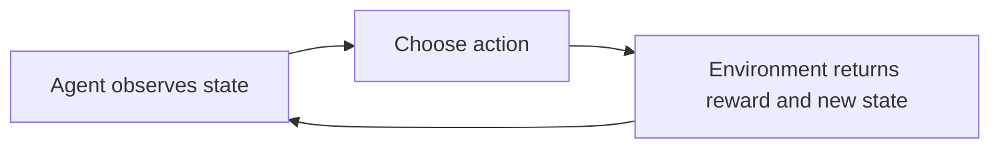
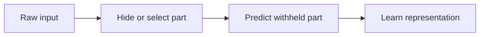

# Mission 3 — Main learning approaches

| Paradigm | Training signal | Output | Suitable when | Limitation |
|---|---|---|---|---|
| Supervised | Input with known target | Class or number | Historical pass/fail outcomes exist | Accurate labels can be costly |
| Unsupervised | Input without supplied targets | Groups or structure | Exploring families of design runs | Groups may lack engineering meaning |
| Reinforcement | Rewards after actions | Action policy | Sequential placement choices | Reward design and exploration are difficult |
| Self-supervised | Targets constructed from input data | Learned representation or predictor | Much unlabelled text/layout data exists | Proxy task may not match final goal |

## Process diagrams

Self-supervised learning is not simply synonymous with unsupervised learning: it creates a prediction target from the data, then optimises a predictive objective. The main three paradigms describe **how learning is guided**, not whether the task is classification or regression. [S1]
