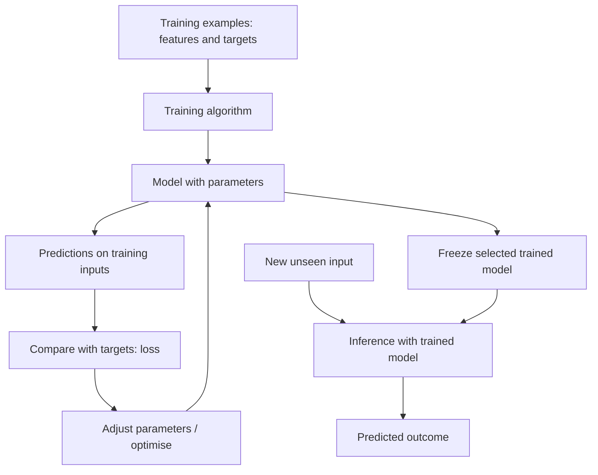

# Mission 5 — Anatomy of an ML model

An **algorithm** is the procedure used to learn; a **model** is the resulting mapping from inputs to outputs; **parameters** are values learned from data (for example a slope and intercept).

**Training** fits parameters using examples. A **loss** describes disagreement between predictions and desired outputs; **optimisation** searches for parameter settings that reduce that loss. **Inference** uses the fitted model on new data without automatically retraining it.

## Linear regression intuition

Imagine estimating delay from logic depth. Linear regression fits a line such as `estimated_delay = intercept + slope × logic_depth` from observed input–delay pairs. The slope and intercept are learned parameters. A new depth is inserted into the fitted equation to estimate delay. A straight-line relationship may be too simple if congestion, wire length and other interactions dominate. [S1, S2]
