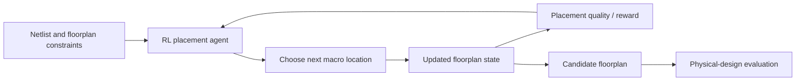

# Mission 9 — Semiconductor case study: reinforcement learning for chip floorplanning

## 1. Engineering context

**Area:** VLSI physical design. **Application:** macro placement / chip floorplanning. A chip contains many connected blocks; engineers must position them within an outline while satisfying physical constraints and seeking good power, performance and area (PPA). Poor placement can cause long interconnects, congestion and timing problems. This case is based on a **published research demonstration with reported production use**, not on a tool I personally operated. [S5, S6]

## 2. Research approach

Mirhoseini and colleagues described a deep reinforcement learning method for chip floorplanning in *Nature* (2021). The agent chooses placements, observes the changing layout state and receives feedback reflecting design quality. A graph-based neural network represents circuit connectivity. Through training, the system learns a policy for selecting placement actions. The authors reported floorplans comparable or superior to human-generated layouts on key metrics for their evaluated designs, and reported use for Google's AI accelerator design. Those are claims about the study and its evaluated settings, **not guarantees for all chips**. [S5]

## 3. Data, inputs, and outputs

**Possible inputs:** macro sizes, block connectivity/netlist graph, chip outline, placement constraints and partial placement state. **Action/output:** a location for the next block and ultimately a candidate floorplan. **Feedback:** reward reflecting proxy quality measures such as wirelength, congestion and density; the complete physical-design flow must still check actual timing and other signoff constraints.

## 4. Task type and learning approach

This is **reinforcement learning**, because actions influence future states and are evaluated using rewards. The primary result is a sequential placement policy rather than a simple pass/fail classifier. Neural networks can support the policy, so it also illustrates deep learning within an engineering optimisation workflow.

## 5. Evaluation plan

Compare generated floorplans with established baselines on **the same circuits and constraints**. Record routed or appropriately validated wirelength, congestion, timing, power, area, constraint violations, and engineering runtime. Use unseen blocks/designs to assess generalisation, repeated trials to assess variability, and clearly separate proxy reward improvements from final signoff PPA. Human review remains necessary.

## 6. Limitations and risks

- A reward is a proxy and can favour layouts that look good by one measure but are poor after routing.
- Different chip architectures, technology nodes or constraints may reduce generalisation.
- Training compute, tool integration and reproducibility may be expensive.
- Reported research success does not establish universal superiority or access to commercial EDA tools.
- Floorplanning is one stage; placement, routing, extraction and signoff still require engineering checks.

## 7. Conclusion

ML is useful here because floorplanning involves a large, interdependent design space where handcrafted rules may be hard to tune. The case shows how an RL agent can propose placements, but evaluation must use physical-design metrics and independent designs. I would treat the method as an engineering assistant whose outputs require verification, not as a replacement for physical-design expertise.

## Sources

- **[S5] Primary paper:** Mirhoseini et al., *A graph placement methodology for fast chip design*, Nature (2021): https://www.nature.com/articles/s41586-021-03544-w — research method, reported evaluation and use.
- **[S6] Google Research explanation:** *Chip Design with Deep Reinforcement Learning* (2020; updated 2021): https://research.google/blog/chip-design-with-deep-reinforcement-learning/ — research context and reported production use.
