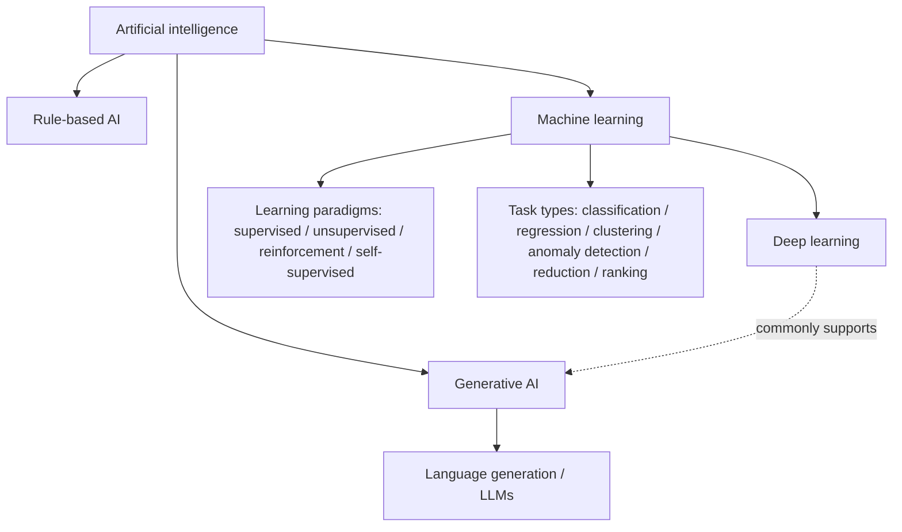
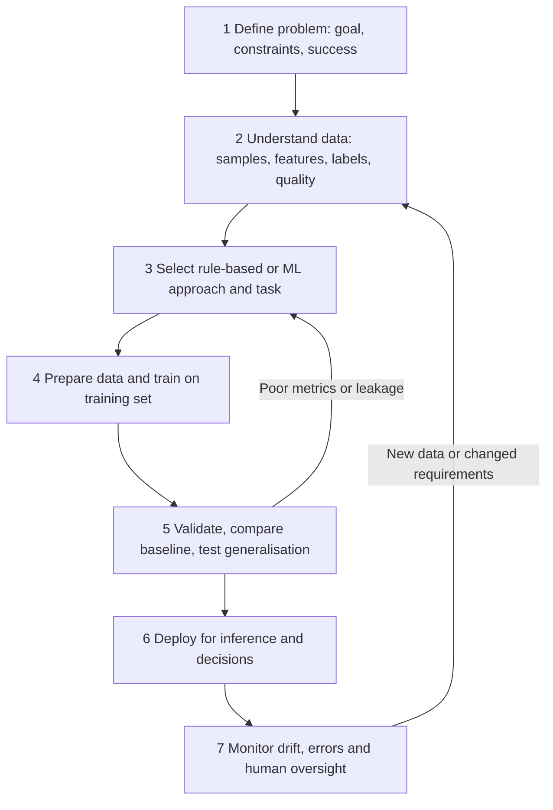

# ML Foundations Map — Final synthesis

## Landscape

Learning paradigms specify **where the learning signal comes from**; task types specify **what result the system is expected to produce**.

## Seven-stage lifecycle

**Failure points:** wrong or unrepresentative data at stage 2; leakage or overfitting at stages 4–5; distribution shift and unchecked false negatives at stages 6–7.

**Semiconductor application:** deep RL for chip macro placement. Inputs include netlist and placement constraints; outputs are placement decisions; quality is checked with PPA-related metrics. **Limitation:** improvements in proxy rewards may not transfer to routed timing, new designs or other process nodes. See Mission 9 and [S5–S6].
